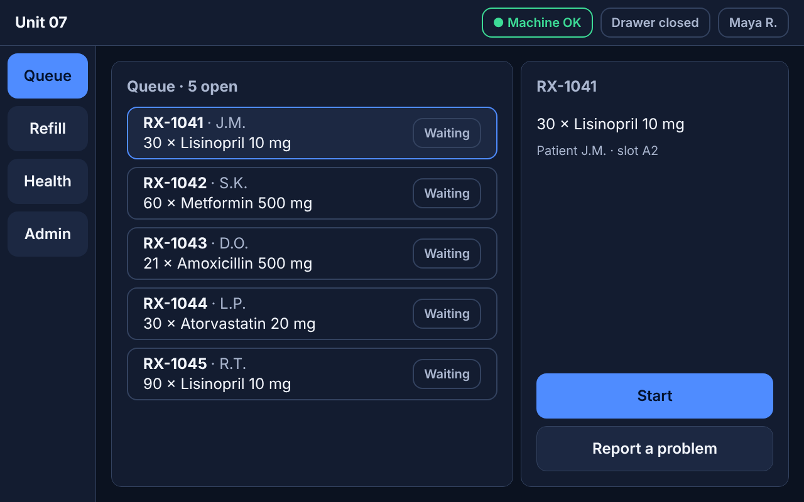
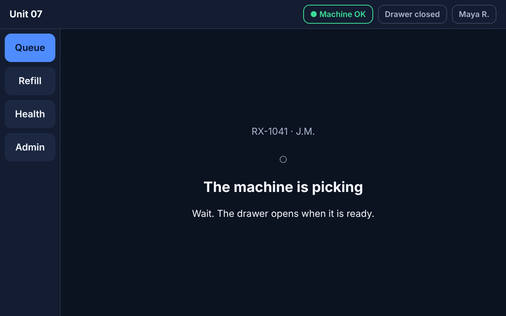
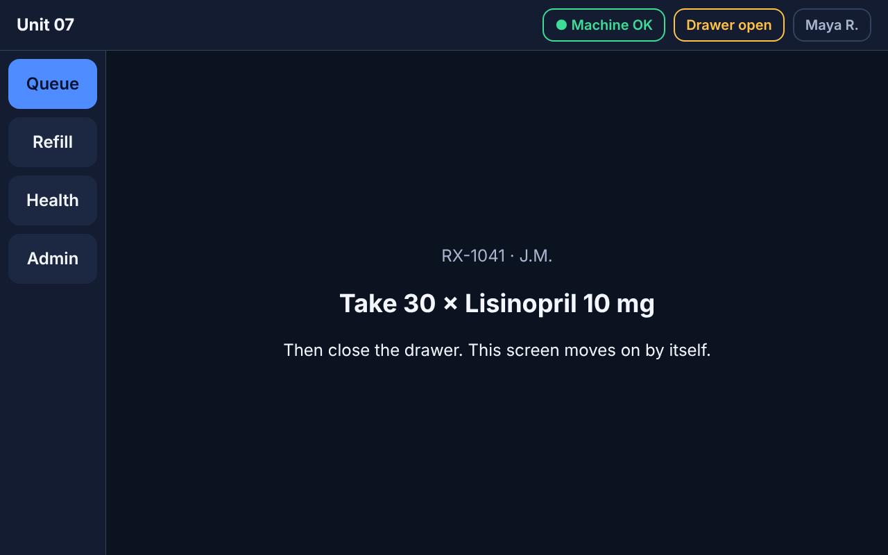
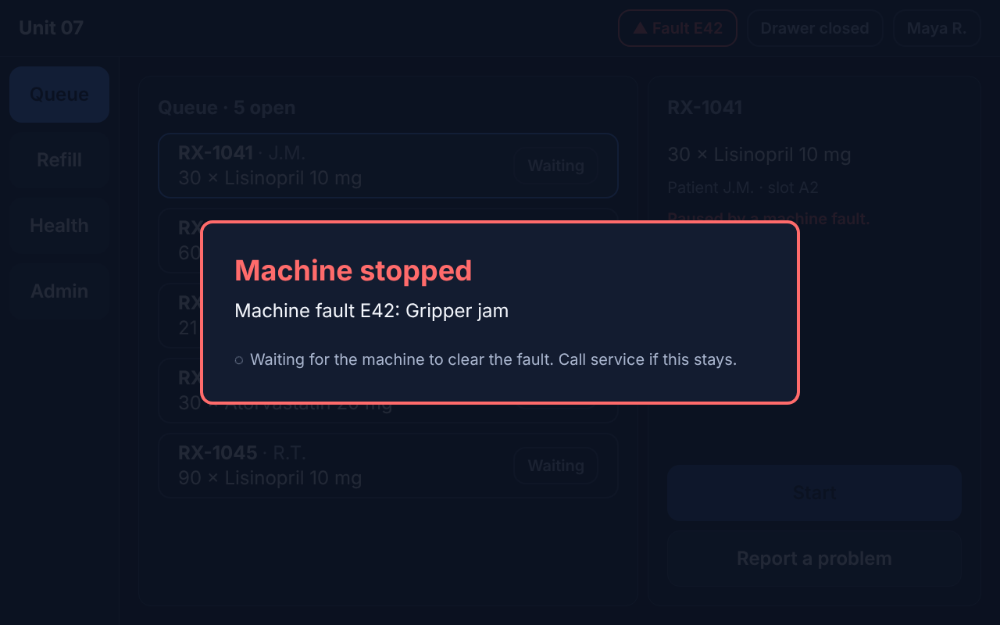

# Operator screen

A touch-only screen for a simulated pharmacy dispensing machine. React 19, TypeScript, Tailwind 4. It is a learning project: the machine is a simulator, and every name, patient and drug is made up. It was built as practice for the kind of front end that is bolted to a machine and used all day by people who are busy with something else.



## What it shows

- **The screen owns no domain state.** The machine (a Node process) holds the queue, the stock, the drawer and the health. It sends the full state over a WebSocket after every change. The screen keeps only the last snapshot and local UI choices (which tab, which row, digits typed on the keypad). A reload, or a dropped connection that comes back, lands on the truth.
- **The screen advances on physical events, not extra taps.** After Start, the machine picks; the screen moves on when the drawer opens, and finishes when it closes. There is no Next button. The [simulator page](#run-it) fires those events.
- **A typed contract that fails the build when it drifts.** `contract/machine.schema.json` describes every message. `npm run contract` generates `src/contract.gen.ts` from it, and `npm run build` fails if that file is stale. In a real product the machine side would be Rust and the types would be generated from it; here the schema file stands in for that.
- **Rules of touch.** No mouse or keyboard. Targets are at least 48 px (most are 72), with a gap between them, text is 20 px or larger, and the PIN keypad is drawn by the app. An action that cannot be undone (removing a prescription) is a long press in its own area, away from the buttons used all day.
- **Three layers of interruption, with one rule.** Ambient status sits in the top bar and never asks for anything. A warning becomes one banner at a time, with a "+N more" count. Only a machine fault blocks the whole screen, and it lifts when the machine clears it, not when someone taps. The rule is `layerOf` in [`src/shared/interrupts.ts`](src/shared/interrupts.ts).
- **Design tokens enforced.** Colours, sizes and spacing live in `src/styles.css`. `npm run lint` fails on a raw hex colour, an arbitrary pixel size, a fixed size under 48 px or text smaller than 20 px anywhere else.

| | | |
| --- | --- | --- |
|  |  |  |
| The machine is picking | The drawer is open | A fault blocks the screen |

## Run it

```
npm install
npm start          # builds, then serves on http://127.0.0.1:3000
```

Open `/` for the screen (PINs `1234` or `4321`) and `/sim` in a second tab for the machine's physical side: open the drawer, close it, jam the gripper, clear the fault. A prescription goes through when you press Start, then open and close the drawer.

```
npm test           # 47 unit tests, with coverage
npm run e2e        # 11 real-browser tests (Chromium via Playwright)
npm run lint       # design-token lint
npm run typecheck
```

## How it is built

| Part | Where |
| --- | --- |
| Machine logic: a pure reducer, `(state, input) -> state or a rejection` | `src/shared/machine.ts` |
| Contract schema and generator | `contract/`, `scripts/gen-contract.ts` |
| Command validation at the wire | `src/shared/commands.ts` |
| WebSocket server (RFC 6455, written for this) and HTTP | `server/` |
| Connection store, a few lines of external-store plumbing | `src/ui/store.ts` |
| Screens and parts | `src/ui/` |
| Build: esbuild plus the Tailwind compiler API | `scripts/build.ts` |

Choices worth a sentence:

- **The reducer is pure and the screen never imports it.** All the reducer tests run with no server and no browser. Rejected commands return the same state object, so a bad tap cannot bump the version.
- **Commands can be refused, and the screen says why.** The machine answers a rejected command with a reason (`insufficient_stock`, `fault_active`, and so on), and the screen shows it in plain words for four seconds. The screen never decides for itself that something is allowed.
- **Wire data is checked at runtime.** Types vanish at runtime, so both directions parse what arrives (`parseCommand`, `parseServerMessage`).
- **The simulator accepts requests from localhost only**, the static server serves a fixed list of files, and the page has a strict Content Security Policy.
- **The WebSocket server is hand-written** (about 100 lines): handshake, text frames, ping and pong, close, a 64 KB limit. It is tested against the RFC's example handshake key. It is not a replacement for a library in production; it keeps the project to almost no dependencies and shows the protocol.

## What this does not do

- **No real machine.** The simulator is the only "hardware". Nothing here is validated for use in a pharmacy, and the data is fake.
- **Not built with the tools of the target stack.** Vite and Vitest were not available where this was built, so it uses esbuild and the Node test runner. The React Compiler was not used; the components follow the Rules of React (pure render, no mutation) but that is not machine-checked. Swapping in Vite and Vitest would be a small change.
- **The "generated from Rust" part is a JSON schema.** The mechanism (generate, then fail the build on drift) is the same; the source is not Rust.
- **Single machine, single screen model.** Several browsers can connect and all see the same state, but there is no sign-in per client, no audit log and no persistence: restarting the server resets everything.
- **Accessibility is partly done.** Roles, labels and live regions are in, and the dialog blocks the page behind it, but I have not tested with a screen reader or run a full WCAG audit.
- **Fixed to a landscape panel.** It is laid out for roughly 1280 by 800. Smaller displays for the later screens are not designed.
- **Types for the React parts** were checked here against a small hand-written stand-in for `@types/react`, because the package could not be installed. Run `npm run typecheck` after `npm install` to check against the real ones.
